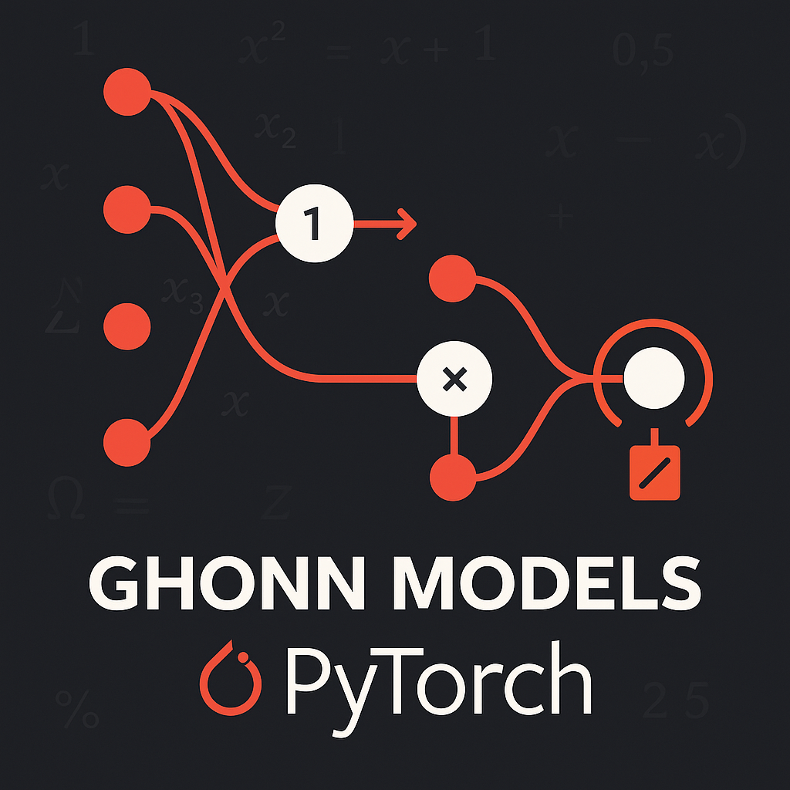

<div align="center">



**Python library with polynomial neural networks**

[](https://www.repostatus.org/#active) [](https://gmp.readthedocs.io/en/latest/)

[](https://pypi.org/project/ghonn-models-pytorch/) [](https://pepy.tech/project/ghonn-models-pytorch) [](https://pepy.tech/project/ghonn-models-pytorch)

[](https://github.com/carnosi/ghonn_models_pytorch/blob/main/LICENSE)

</div>

**GHONN Models Pytorch** brings advanced neural architectures to your PyTorch projects: Higher Order Neural Units (HONU), Higher Order Neural Networks (HONN), Gated Higher Order Neural Units (GHONU), Gated Higher Order Neural Networks (GHONN), and the Self-Attention Gated Higher Order Neural Network (SA-GHONN).

✨ **Polynomial neurons at the core:** These models represent nonlinear relationships using polynomial features. Accuracy and computational cost depend on the data, feature count, and polynomial order.

🔗 **Gated variants for extra power:** The gated architectures use a dual HONU neuron setup—one as a dynamic gate, the other as the main predictor—enabling richer and more expressive modeling.

🧠 **Full forecasting network:** SA-GHONN normalizes the input (optionally with RevIN), decomposes it into trend, seasonal, and residual signals, processes them with first-order gated, Conv-GHONU, and GHONU experts, then mixes the stacked branches with self-attention before a delta-MLP forecast decoder.

🛠️ **Modular and flexible:** Build your own architectures with ease. Layers can be stacked directly or connected via linear mappings, giving you full control over your network’s structure.

👉 **Curious how it works in practice?** Check out the example notebooks and usage guides included in this repository.

## 📖 [Project Documentation](https://gmp.readthedocs.io/) 📖
Visit [Read The Docs Project Page](https://gmp.readthedocs.io/) or read the following README to know more about Gated Higher Order Neural Network Models Pytorch (GHONN for short) library.

## ✨ Features <a name="features"></a>

- **Polynomial neurons:** Capture complex, nonlinear relationships using higher-order neural units.
- **Gated architectures:** Leverage dual-neuron setups for richer modeling capacity.
- **SA-GHONN:** Use a complete self-attention forecasting network built around HONU/GHONU components.
- **Conv-GHONN:** Apply GHONU polynomial filters to causal temporal windows for sequence feature extraction.
- **Modular design:** Easily stack and combine layers for custom architectures.
- **Vectorized computation:** Grouped neurons share polynomial evaluation; optional monomial chunking limits the size of intermediate evaluations.
- **Seamless PyTorch integration:** All components are standard PyTorch modules.
- **Supports regression & classification:** Flexible for a wide range of ML tasks.
- **Ready-to-use examples:** Example notebooks and guides included.

**Neuron Types** ⚡
- **HONU:** The fundamental building block for higher-order modeling. For example, a 2nd order HONU is defined as:

  

  where:
  - $\tilde{y}(k)$ is the neuron output for input sample $k$
  - $w_{i,j}$ are the learnable weights
  - $x_0=1$ is the constant feature when `bias=True`; the remaining $x_i, x_j$ are input features
  - $\mathbf{w}$ is the weight vector
  - $\mathrm{col}^{r=2}(\mathbf{x})$ is the column vector of all 2nd order combinations of input features
  - $r$ is the polynomial order

  With `bias=True`, the basis includes constant and lower-degree terms. With `bias=False`, it contains only terms of exactly the requested order.
- **gHONU:** Combines two HONUs—one as a predictor (typically linear activation), the other as a dynamic gate (e.g., `tanh`)—multiplying their outputs for enhanced ability to capture complex patterns.

**Network Layers** 🧩
- **HONN:** Single-layer networks of HONU neurons. Supports both raw outputs for stacking and linear heads for custom output dimensions.
- **gHONN:** Single-layer networks of gHONU neurons, with the same flexible output options as HONN.

**Full Models and Components** 🧠
- **SA-GHONN:** Self-attention Gated Higher-Order Neural Network forecaster. The pipeline is `RevIN` (optional) -> trend/seasonal/residual moving-average decomposition -> first-order gated GHONU, Conv-GHONU, and GHONU experts -> branch-stack self-attention -> delta-MLP forecast decoder.
- **`HonuBank` and `GhonuBank`:** Grouped, vectorized banks of HONU and GHONU neurons.
- **`ConvGhonn` (Conv-GHONN):** Applies GHONU polynomial filters to causal temporal windows. `ConvGhonn1D` applies independent polynomial filters per temporal input feature.
- **`RevIN`:** Reversible instance normalization for non-stationary time series.

**Why Choose GHONN Models?** 🚀
- **Explicit polynomial basis:** For `n` inputs and order `r`, a biased HONU has `binomial(n + r, r)` monomials. Cost grows combinatorially; chunking does not remove the full weight and index storage.
- **Flexible & modular:** Easily stack, combine, or adapt layers and neurons for custom architectures.
- **PyTorch-native:** All components are standard PyTorch modules for seamless integration.
- **Versatile:** Supports both regression and classification tasks.
- **Quick start:** Example notebooks and guides included to help you get going fast.

## 🧪 Examples & Usage <a name="examples"></a>

You can find helpful, step-by-step Jupyter notebooks in the [examples](./examples/) folder, which offer practical demonstrations and implementation suggestions.

Both notebooks fit normalization on training data only. The Air Passenger
example demonstrates rolling one-step evaluation and a recursive future forecast.
The ETTh1 example also demonstrates validation checkpoint selection. These are
usage examples, not evidence of benchmark or multi-step forecast accuracy.

You may also find the code snippets below useful as a starting point.

**HONU initialization**
```python
import ghonn_models_pytorch as gmp

kwargs = {
    "weight_divisor": 100,  # Scales weights only with weight_init_mode="random"
    "bias": True            # Whether to use a bias term in the model
}

# Create a Higher Order Neural Unit (HONU) with 3 inputs and degree 2
honu_neuron = gmp.HONU(
    in_features=3,          # Number of input features
    order=2,                # Degree of the polynomial
    activation="identity",  # Activation function
    **kwargs
)
```

**HONN initialization**
```python
import ghonn_models_pytorch as gmp

kwargs = {
    "weight_divisor": 100,
    "bias": True
}

# Create single HONU based layer - HONN with 4 neurons of different orders and activation functions.
honn_layer = gmp.HONN(
    in_features=3,                          # Number of input features
    out_features=2,                         # Number of output features
    layer_size=4,                           # Number of neurons in the layer
    polynomial_orders=(2, 3),               # Degree of the polynomials; cycles if shorter than layer_size
    activations=("identity", "sigmoid"),    # Activation functions for the neurons in the layer. If shorter work like a rolling buffer
    output_type="linear",                   # Output type of the layer. Can be "linear" or "sum" or "raw"
    **kwargs
)
```
**Neuron, Layer or Model training as usual**
```python
import torch

# Synthetic regression data for the two-output HONN above.
data = torch.randn(32, 3)
targets = torch.randn(32, 2)
batch_size = 8
criterion = torch.nn.MSELoss()
optimizer = torch.optim.Adam(honn_layer.parameters(), lr=1e-3)
honn_layer.train()
for i in range(0, data.size(0), batch_size):
    batch = data[i:i + batch_size]
    target = targets[i:i + batch_size]
    optimizer.zero_grad(set_to_none=True)
    output = honn_layer(batch)
    loss = criterion(output, target)
    loss.backward()
    optimizer.step()
```

## 💡 Tips & Tricks <a name="tips_n_tricks"></a>

**Default SA-GHONN initialization**
```python
import torch
import ghonn_models_pytorch as gmp

# Forecast 12 steps from a 24-step, 3-feature input sequence.
sa_ghonn = gmp.SAGHONN(
    input_length=24,
    in_features=3,
    out_features=12,
)

sequence = torch.randn(8, 24, 3)
forecast = sa_ghonn(sequence)
# forecast.shape == (8, 12, 1)
```

SA-GHONN uses a 96-step trend moving average, a 3-step seasonal moving
average, width 96, and one eight-head attention layer. The trend expert has
a first-order predictor and a sigmoid gate (so the expert is not linear).
The trend and residual experts use the current timestep plus three past
steps by default. The seasonal expert uses 16 independent 9-step filters
per input feature with centered padding, then projects to width 96.
`out_features` is the forecast horizon; `predicted_feature_indices=(0,)`
selects feature 0 by default. Output shape is
`(batch, out_features, len(predicted_feature_indices))`.
These defaults do not imply benchmark performance for arbitrary data.

Predictor and gate learning rates can be tuned separately; see the
[optimizer examples](docs/source/insights.rst).

## 🛠️ Installation <a name="installation"></a>

Requires Python 3.12 or newer. Dependency constraints are defined in
[pyproject.toml](pyproject.toml); the current source requires PyTorch `~=2.13`.
The PyPI release may differ from the current repository.

**PyPI version:**
```bash
pip install ghonn-models-pytorch
```

**The latest version from GitHub:**
```bash
pip install git+https://github.com/carnosi/ghonn_models_pytorch
```

For a local checkout, install optional dependencies as needed:

```bash
python -m pip install -e ".[examples,docs,dev]"
python -m sphinx -b html docs/source docs/build/html
python -m pytest tests/
```

## Compatibility notice
The version 0.2+ API uses vectorized PyTorch modules and does not guarantee backward compatibility with
earlier releases. `HONU` accepts inputs shaped `(..., in_features)` and returns
`(..., out_features)` with at least one leading batch dimension. A `GHONU` with `gate_order=0` omits its gate and behaves as a HONU.
Gates can be frozen with standard PyTorch controls:

```python
ghonu = gmp.GHONU(in_features=3)
if ghonu.gate is not None:
    ghonu.gate.requires_grad_(False)
```

## 📚 References <a name="references"></a>
This repository is inspired by the foundational research presented in the following papers. While the original studies utilized legacy implementations, this PyTorch-based version provides PyTorch implementations of related architectures; it does not establish numerical equivalence or a performance advantage over those studies.

**HONU**:
```plaintext
[1] P. M. Benes and I. Bukovsky, “Railway Wheelset Active Control and Stability via Higher Order Neural Units,” IEEE/ASME Transactions on Mechatronics, vol. 28, no. 5, pp. 2964–2975, Oct. 2023, doi: 10.1109/TMECH.2023.3258909.

[2] I. Bukovsky, G. Dohnal, P. M. Benes, K. Ichiji, and N. Homma, “Letter on Convergence of In-Parameter-Linear Nonlinear Neural Architectures With Gradient Learnings,” IEEE Transactions on Neural Networks and Learning Systems, vol. 34, no. 8, pp. 5189–5192, Aug. 2023, doi: 10.1109/TNNLS.2021.3123533.

[3] I. Bukovsky, “Deterministic behavior of temperature field in turboprop engine via shallow neural networks,” Neural Comput & Applic, vol. 33, no. 19, pp. 13145–13161, Oct. 2021, doi: 10.1007/s00521-021-06013-7.

[4] P. M. Benes, I. Bukovsky, M. Vesely, J. Voracek, K. Ichiji, and N. Homma, “Framework for Discrete-Time Model Reference Adaptive Control of Weakly Nonlinear Systems with HONUs,” in Computational Intelligence, C. Sabourin, J. J. Merelo, K. Madani, and K. Warwick, Eds., Cham: Springer International Publishing, 2019, pp. 239–262. doi: 10.1007/978-3-030-16469-0_13.
```
**GHONU**:
```plaintext
[1] O. Budik, I. Bukovsky, and N. Homma, “Potentials of Gated Higher Order Neural Units for Signal Decomposition and Process Monitoring,” Procedia Computer Science, vol. 253, pp. 2278–2287, Jan. 2025, doi: 10.1016/j.procs.2025.01.288.
```

### Our other project

**[AISLEX](https://github.com/carnosi/AISLEX)**: A Python package for Approximate Individual Sample Learning Entropy (LE) anomaly detection. Easily integrate LE-based novelty detection into your neural network workflows, with both Python and JAX implementations.

## 📝 How To Cite <a name="how_to_cite"></a>
If `ghonn_models_pytorch` has been useful in your research or work, please consider citing our article:

```plaintext
Work in progress. Use GHONU (10.1016/j.procs.2025.01.288) for now please.
```

The GHONU reference above provides the article title, authors, and DOI.
## 📄 License <a name="license"></a>

This project is licensed under the terms of the [MIT License](https://github.com/carnosi/ghonn_models_pytorch/blob/main/LICENSE).
